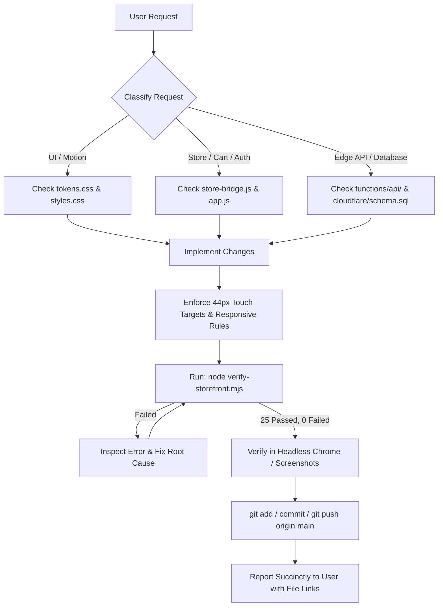

# AGENTS.md — AI Agent Operating Manual & Repository Directives

> **Repository:** `vistara-krafts` (Stitch Pottery & Resin Keepsake E-Commerce Storefront)  
> **Brand:** Vistāra Krafts Studio & Chemical Atelier (`@resin.art.memories`) & POTRY Ceramics  
> **Production URL:** `https://vistara-krafts.vercel.app` (Custom domain target: `https://vistarakrafts.in`)  
> **Author & Architect:** Antigravity Super-Designer & Principal Systems Architect  
> **Last Updated:** October 2026  

---

## 1. Prime Directives for All AI Agents

When modifying, auditing, or extending this repository, every AI agent (Antigravity, Claude, Codex, Gemini, or CI bots) must strictly uphold these six core invariants:

1. **Zero Admin UI Leakage:**
   - This web application is **strictly customer-facing**.
   - There must **never** be an admin panel, owner dashboard, vendor login, inventory modifier, or CMS editor embedded in this codebase.
   - The admin panel operates as an entirely decoupled system that pushes updates directly to the backend database (Cloudflare D1 / Cloudflare R2). This website merely reads and synchronizes state with the database and edge storage.

2. **Backend Authority (Cloudflare Ecosystem Only):**
   - The backend is architected exclusively for **Cloudflare** (Cloudflare Pages, Cloudflare Pages Functions `/api/*`, Cloudflare D1 Serverless SQL, Cloudflare KV edge sessions, Cloudflare R2 media storage, and Cloudflare Turnstile bot verification).
   - **Do NOT re-introduce Supabase, Firebase, or AWS libraries.** If a user asks about database persistence, ground all implementations in Cloudflare D1 (`cloudflare/schema.sql`) and `functions/api/[[route]].js`.

3. **Two-Part Authentication & Curation Flow (Strict User Rule):**
   - **Part 1 (Credentials Only):** The user signs in or registers via Email/Password, 1-Click Google OAuth, or Apple ID. **No male or female persona questions are allowed in Part 1.**
   - **Part 2 (Curation Step):** After authentication and profile details are complete, the user is presented with Part 2: "Curate Your Studio Feed".
   - **Gender Options:** Strictly `👔 Male` and `🌸 Female`.
   - **No "Universal" Button:** The word or button "Universal" must **never** appear as an option. If the user dismisses the dialog (via `✕` Close or "Skip for Now & Continue"), the system silently defaults to the universal feed (`persona = 'all'`) without ever exposing a "Universal" button.

4. **Desktop & Mobile Modal Geometry:**
   - **Computer / Desktop Screens (`>= 768px`):**
     - **Left Side (`order-1`, `md:w-7/12`):** The clean, warm ivory/alabaster login and curation form is displayed.
     - **Right Side (`order-2`, `.auth-desktop-showcase`, `md:w-5/12`):** The **Vistāra Krafts 3D Liquid Resin Animation Showcase** is running (displaying the 140px floating liquid resin specimen sphere, concentric rotating golden orbit rings, studio crest, and trust badges).
     - **CSS Rule:** Do NOT use Tailwind's `hidden md:flex` on `.auth-desktop-showcase` because `styles.css` defines `.hidden { display: none !important; }`. Always use `.auth-desktop-showcase` with its dedicated `@media (min-width: 768px) { display: flex !important; }` rule.
   - **Mobile Screens (`< 768px`):**
     - Single-column flow. The right showcase hides automatically.
     - Centered at the top of the mobile form is the glowing 3D resin orb specimen, followed by the credentials form (Part 1), which transitions cleanly to Part 2 on sign-in.

5. **60/30/10 Warm Gallery Brand Palette:**
   - **60% Canvas & Cards:** Warm Alabaster (`#faf8f5`), Pure Gallery White (`#ffffff`), Warm Mist (`#f3f1ec`).
   - **30% Structure & Authority:** Deep Naval Sapphire (`#031a38`), Hairline Stone Borders (`#e4e0d8`), Slate Ink (`#1e293b`).
   - **10% Artisan Accents:** Antique Brass (`#b08d57`), Warm Gold Flecks (`#ffd79b`), Crimson Vermilion (`#9e3322`).
   - Never use cold pitch-black obsidian backgrounds or generic Bootstrap grey layouts.

6. **Non-Negotiable Verification Standard:**
   - Before committing or claiming success, you **MUST run `node verify-storefront.mjs`** and verify that all 25 test suites pass cleanly (`25 passed, 0 failed`).
   - Every interactive control (button, input, select, tab) must have `min-height: 44px` (WCAG 2.2 AA touch target size).
   - Zero horizontal overflow across viewports from 320px to 1920px.

---

## 2. Agent Workflow & Execution Rules



---

## 3. Directory Layout & File Responsibilities

| File / Directory | Size / Type | Primary Responsibility |
| :--- | :--- | :--- |
| [`index.html`](file:///C:/Users/Dell/.gemini/antigravity/scratch/stitch_potry_e_commerce_storefront/index.html) | ~160 KB HTML | Complete single-page application shell, semantic containers, modals (`#cloudflare-auth-modal`, `#checkout-modal`, `#dpdp-consent-banner`, `#vk-splash-modal`), and SEO/JSON-LD metadata. |
| [`app.js`](file:///C:/Users/Dell/.gemini/antigravity/scratch/stitch_potry_e_commerce_storefront/app.js) | ~410 KB JS | Core client application router (7 customer routes: `home`, `catalog`, `pdp`, `custom-studio`, `cart`, `account`, `editorial`), UI state machine (`AppState`), and view renderers. |
| [`store-bridge.js`](file:///C:/Users/Dell/.gemini/antigravity/scratch/stitch_potry_e_commerce_storefront/store-bridge.js) | ~117 KB JS | In-memory + LocalStorage transactional store bridge (`StorefrontBridge`, `VistaraStore`), volume tier discounts, GST calculation, wishlist sync, cart persistence, and auth mock engine. |
| [`styles.css`](file:///C:/Users/Dell/.gemini/antigravity/scratch/stitch_potry_e_commerce_storefront/styles.css) | ~25 KB CSS | Keyframe animations (`vkOrbFloat`, `vkOrbitalRotate`, `authModalPop`), 3D glass specimen orb shading, button shimmer, and custom scrollbar styles. |
| [`tokens.css`](file:///C:/Users/Dell/.gemini/antigravity/scratch/stitch_potry_e_commerce_storefront/tokens.css) | ~4 KB CSS | W3C Design Tokens, CSS variables for 60/30/10 warm gallery palette, typography scale, elevation shadows, and touch target tokens. |
| [`cloudflare-config.js`](file:///C:/Users/Dell/.gemini/antigravity/scratch/stitch_potry_e_commerce_storefront/cloudflare-config.js) | ~8 KB JS | Environment manager (`development` vs `production`), Turnstile sitekeys, OAuth client IDs, and canonical URL generators. |
| [`functions/api/[[route]].js`](file:///C:/Users/Dell/.gemini/antigravity/scratch/stitch_potry_e_commerce_storefront/functions/api/[[route]].js) | ~37 KB JS | Cloudflare Pages Function edge router handling `/api/auth/*` (register, login, oauth, profile, me, logout) and `/api/orders` with D1 database binding and fallback in-memory cache. |
| [`cloudflare/schema.sql`](file:///C:/Users/Dell/.gemini/antigravity/scratch/stitch_potry_e_commerce_storefront/cloudflare/schema.sql) | ~2 KB SQL | D1 SQLite production database schema defining `users`, `sessions`, and `orders` tables with foreign keys and indexes. |
| [`verify-storefront.mjs`](file:///C:/Users/Dell/.gemini/antigravity/scratch/stitch_potry_e_commerce_storefront/verify-storefront.mjs) | ~127 KB JS | Comprehensive automated verification suite with 25 test suites, real headless Chrome CDP tests, responsive multi-viewport audits, and state assertions. |

---

## 4. Key Architectural Patterns to Preserve

### A. Two-Part Auth Modal Controller State
```javascript
// Step 1: Show credentials (email/pwd/oauth)
window.showAuthStep('credentials');

// Step 2: Show curation preferences after successful sign-in
window.showAuthStep('curation');

// Finish with preference
window.selectPersonaAndFinish('masculine'); // or 'feminine'

// Finish without preference (silent universal stage)
window.skipPersonaAndFinish(); // sets persona to 'all'
```

### B. Feed Persona Synchronizer
```javascript
// Sets persona and notifies subscriber views
window.setFeedPersona('masculine'); // or 'feminine' / 'all'
Store.setPersonaPreference('masculine');
AppState.feedPersona = 'masculine';
renderActiveView();
```

### C. Safe Dual Persistence (In-Memory + LocalStorage Fallback)
`store-bridge.js` implements a resilient proxy around `localStorage`. If `localStorage` throws `SecurityError`, `QuotaExceededError`, or is disabled (e.g. private browsing or sandboxed iframes), the application automatically falls back to in-memory state without crashing or freezing.

---

## 5. Pre-Commit Checklist for Autonomous Agents

Before pushing any commit, verify that you can check off every item:

- [ ] Ran `node verify-storefront.mjs` and achieved `25 passed, 0 failed`.
- [ ] No mention of "Universal" button on login or curation modal.
- [ ] Login screen on desktop displays form on LEFT and 3D animation on RIGHT.
- [ ] Login screen on mobile displays single column with 3D resin orb at the top.
- [ ] No admin panel or owner controls added to the storefront.
- [ ] All buttons and inputs maintain `>= 44px` height and do not overflow at 320px viewport.
- [ ] No dark obsidian backgrounds used for primary cards; all styled with warm alabaster/ivory tokens.
- [ ] Working tree is clean and changes pushed to `origin/main`.
