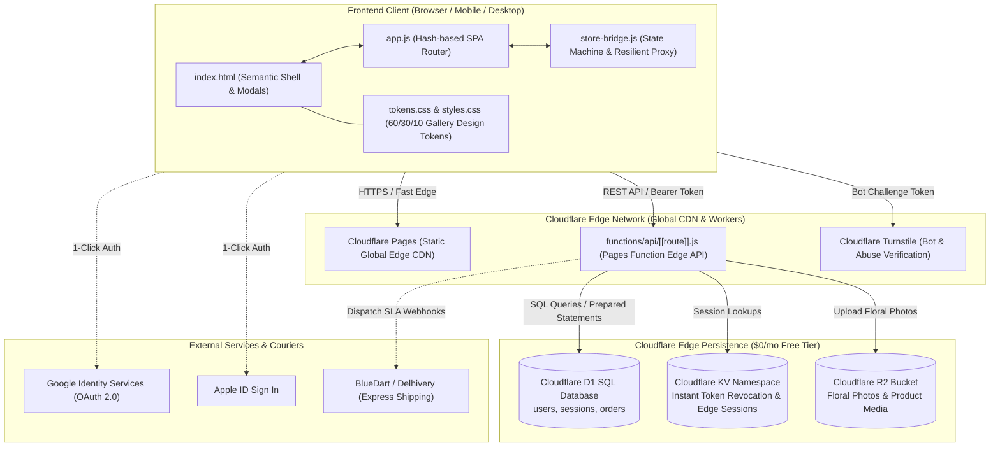
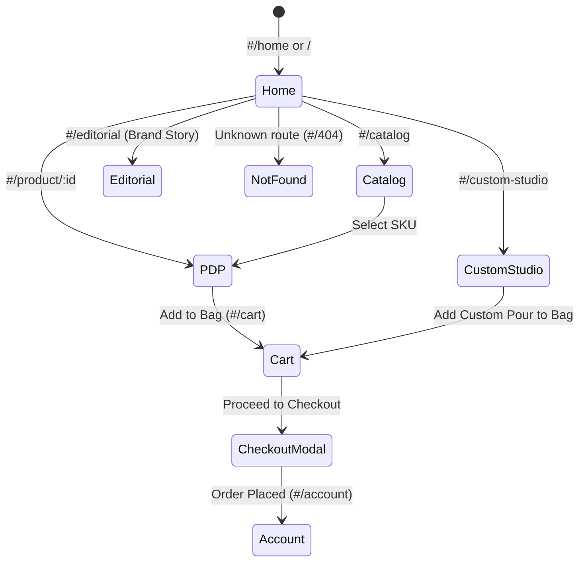
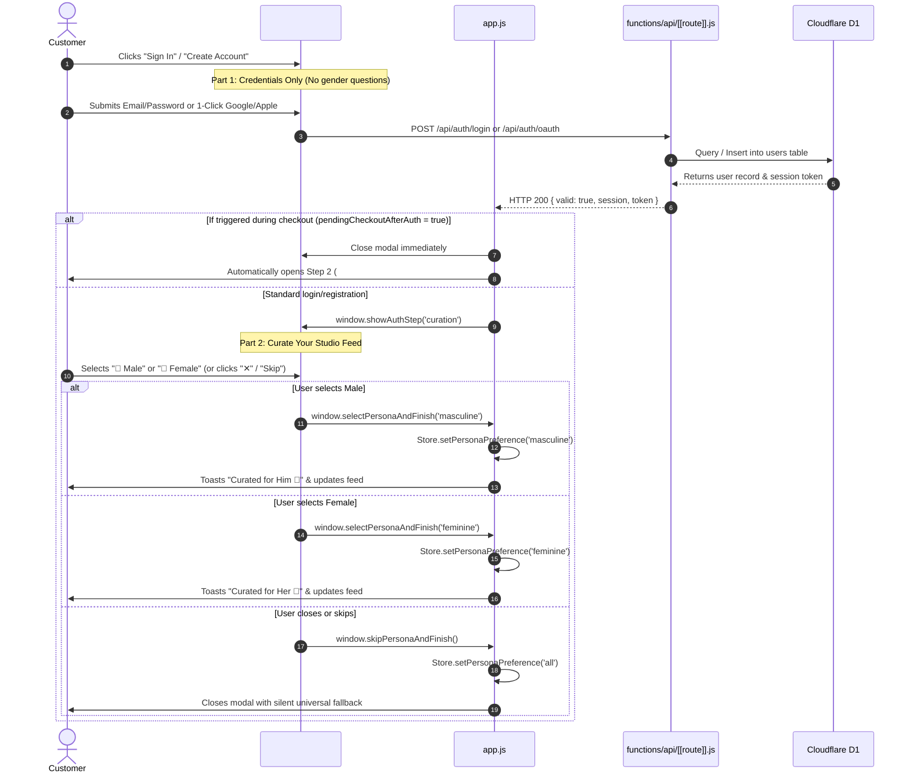
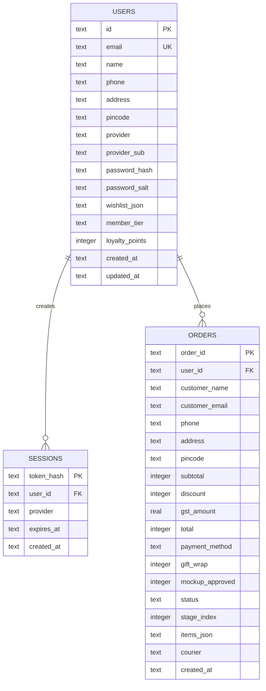

# SYSTEM ARCHITECTURE — VISTĀRA KRAFTS

> **System Type:** Edge-First Full-Stack E-Commerce Storefront  
> **Client Framework:** Semantic HTML5 Shell + Vanilla ES Modules + Vite 5  
> **Edge Runtime:** Cloudflare Pages Functions (V8 Workers Runtime)  
> **Database:** Cloudflare D1 Serverless SQL (SQLite engine)  
> **Media & Storage:** Cloudflare R2 Object Storage (S3-compatible, $0 egress)  
> **Security & Bot Defense:** Cloudflare Turnstile + DPDP Act 2023 Consent Vault  

---

## 1. High-Level System Architecture Diagram



---

## 2. Core Architectural Subsystems

### A. Client-Side SPA Routing Engine (`app.js`)
The application operates on an ultra-lightweight, zero-framework hash router supporting 7 dedicated customer-facing routes:



#### Route Definitions
1. `#/home` — Curated flagship hero, interactive specimen loupe, collection rails, and Feed Curation bar.
2. `#/catalog` — Full 12-item catalog with filtering by collection (Resin Keepsakes, Chemicals, Ceramics) and persona sorting (`gifts_him`, `gifts_her`, `gifting`, price).
3. `#/product/:id` — High-converting Product Detail Page (PDP) with multi-image gallery, volume tier pricing, stock levels, and resin technical specifications.
4. `#/custom-studio` — Interactive Resin Pour Calculator (Part B) and bespoke floral preservation quotation builder.
5. `#/cart` — Studio bag review, line-item quantity controls, coupon code validator (`KRAFTFIRST`), and volume discount breakdown.
6. `#/account` — Authenticated patron dashboard showing order tracking stages, GST invoice viewer, and DPDP personal data rights tools.
7. `#/editorial` — Chemical atelier heritage, HALS UV stabilization science, and POTRY ceramic craftsmanship story.

---

### B. Two-Part Authentication & Curation Flow

The sign-in experience is engineered into two discrete, uncrowded stages to maximize conversion and respect user context:



---

### C. Desktop Two-Stage Modal Architecture

On desktop screens (`>= 768px`), `#cloudflare-auth-modal` expands into an atelier two-stage layout:

```
+---------------------------------------------------------------------------------------+
|  #cloudflare-auth-modal inner card (max-w-4xl, rounded-3xl, warm alabaster border)     |
+---------------------------------------------------+-----------------------------------+
|  LEFT STAGE (md:w-7/12, order-1, bg-white)        |  RIGHT STAGE (.auth-desktop-showcase, |
|                                                   |  md:w-5/12, order-2, deep navy)   |
|  [Back Arrow]    [VK Crest]         [Close ✕]     |                                   |
|                                                   |  [VK Monogram] VISTĀRA KRAFTS     |
|  Part 1: Credentials                              |  Artisan Resin Studio             |
|  • "Welcome Back!" / "Create Account"             |                                   |
|  • Tabs: Sign In | Create Account                 |       ( ( (  3D ORB  ) ) )        |
|  • Email Address *                                |     140px Floating Specimen       |
|  • Password * [Visibility Icon]                   |     with Concentric Brass Rings   |
|  • Remember Me | Forgot Password?                 |                                   |
|  • [Primary CTA: Sign In]                         |  "Preserved Memories in Glass"    |
|  • -- Or continue with --                         |  Handcrafted luxury resin art.    |
|  • [Google] [Apple]                               |                                   |
|  • 🛡️ 100% Secure Sign-In • Private & Protected   |  • 👔 / 🌸 Curated Collections     |
|                                                   |  • 🛡️ 100% Secure Sign-In         |
|  Part 2: Curation (Swapped after login)           |  • 📦 Track Pours Across India    |
|  • "Curate Your Studio Feed"                      |                                   |
|  • [ 👔 Male: Curated for Him ]                   |                                   |
|  • [ 🌸 Female: Curated for Her ]                 |                                   |
|  • [ Skip for Now & Continue ]                    |                                   |
+---------------------------------------------------+-----------------------------------+
```

---

## 3. Database Schema (Cloudflare D1 / SQLite)

The schema in [`cloudflare/schema.sql`](file:///C:/Users/Dell/.gemini/antigravity/scratch/stitch_potry_e_commerce_storefront/cloudflare/schema.sql) enforces strict relational integrity:



---

## 4. Design System & CSS Token Architecture

All styling is anchored to W3C Design Tokens defined in [`tokens.css`](file:///C:/Users/Dell/.gemini/antigravity/scratch/stitch_potry_e_commerce_storefront/tokens.css):

```css
:root {
  /* 60% Canvas & Cards */
  --surface-60-canvas: #faf8f5;
  --surface-60-card: #ffffff;
  --surface-60-mist: #f3f1ec;

  /* 30% Structure & Authority */
  --structure-30-navy: #031a38;
  --structure-30-border: #e4e0d8;
  --structure-30-ink: #1e293b;

  /* 10% Artisan Accents */
  --accent-10-brass: #b08d57;
  --accent-10-gold: #ffd79b;
  --accent-10-vermilion: #9e3322;

  /* Typography */
  --font-editorial: 'Playfair Display', Georgia, serif;
  --font-body: 'Inter', system-ui, -apple-system, sans-serif;

  /* Minimum Accessible Touch Target */
  --touch-target-min: 44px;
}
```
