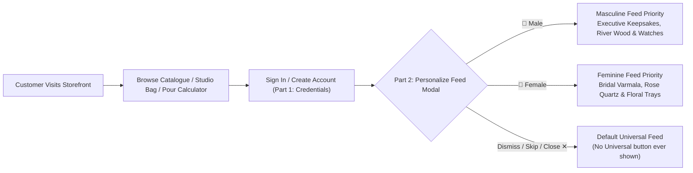

# PROJECT CONTEXT — VISTĀRA KRAFTS

> **Brand Identity:** Vistāra Krafts Studio & Chemical Atelier (`@resin.art.memories`)  
> **Sister Brand:** POTRY Contemporary Ceramic Studio  
> **Headquarters & Studio:** Bengaluru, Karnataka, India (560001)  
> **Primary Domains:** Bridal Keepsake Preservation, Optical Epoxy Chemical Formulation, Contemporary Ceramic Homeware  

---

## 1. Brand Heritage & Vision

**Vistāra Krafts** is India’s foremost bridal varmala memory preservation studio and an ISO 9001:2015 certified manufacturer of high-purity optical epoxy casting systems. Operating primarily through its Instagram atelier (`@resin.art.memories`), the studio transforms perishable wedding garlands (*varmalas* / *jaimalas*), anniversary bouquets, and sacred celebration florals into forever-lasting, diamond-clear acrylic-epoxy crystal blocks.

Recognizing that customers frequently seek complementary tactile home décor, the brand integrates **POTRY**, an artisanal ceramic studio crafting stoneware pitchers, wabi-sabi planters, and textured tableware.

### Core Business Pillars
1. **Bespoke Memory Preservation:** White-glove floral dehydration, colour restoration, multi-layer bubble-free casting under pressure chambers, and diamond polishing.
2. **Speciality Chemical Supply:** Laboratory-formulated, non-yellowing epoxy systems (3:1 casting, 2:1 deep pour, 1:1 topcoat, and 1-part UV resin) for Indian artists, architects, and woodworkers.
3. **Curated Gifting & Tactile Décor:** Ready-to-ship ocean resin trays, geode wall art, and POTRY ceramic tableware.

---

## 2. Customer Personas & Feed Personalization Model

To streamline purchasing and increase gifting conversion, Vistāra Krafts implements an intelligent **Two-Part Curation Architecture**:

### Personas Defined

#### 1. Curated for Him (`masculine`)
- **Target Products:** Deep Pour river tables (`vk-epx-201`), geometric watch keepsakes, executive resin coasters, dark obsidian finishes, and POTRY charcoal planters (`potry-ceramic-002`).
- **Gifting Occasions:** Groom's boutonniere preservation, corporate anniversary gifts, housewarming décor.

#### 2. Curated for Her (`feminine`)
- **Target Products:** Eternal 50mm Varmala Blocks (`ram-varmala-001`), Rose Quartz Preservation Trays (`ram-varmala-002`), Amethyst Geode Wall Art (`vk-geode-001`), and blush ceramic tableware.
- **Gifting Occasions:** Wedding garland preservation, bridal shower keepsakes, festive home styling.

#### 3. Universal Stage (`all` — Silent Default)
- **Constraint:** The user must **never** see a button or tab labeled "Universal". If the user chooses neither `👔 Male` nor `🌸 Female` (e.g. they close the modal or click "Skip for Now & Continue"), they remain in this balanced, un-skewed state.

---

## 3. Product Catalogue & Inventory Domain (12 Flagship Items)

The storefront features 12 master products spanning three distinct product lines:

| SKU | Product Title | Brand | Category | Affinity | Base Price (INR) | Key Feature |
| :--- | :--- | :--- | :--- | :--- | :--- | :--- |
| `ram-varmala-001` | Eternal Varmala 50mm Floral Keepsake Block | Resin Art Memories | Keepsake | Feminine | ₹4,499 | 50mm thick diamond crystal, 3-layer UV seal |
| `ram-varmala-002` | Bridal Rose Quartz Floral Preservation Tray | Resin Art Memories | Keepsake | Feminine | ₹5,999 | Genuine rose quartz chips, gold leaf handles |
| `vk-epx-301` | UltraClear 3:1 Optical Casting Resin Kit (1.2kg) | Vistāra Krafts | Chemical | Unisex | ₹1,299 | ISO-9001, HALS UV stabilizer, bubble-release |
| `vk-epx-201` | Deep Pour 2:1 River Table Epoxy System (3kg) | Vistāra Krafts | Chemical | Masculine | ₹2,899 | Pours up to 50mm per layer without exotherm |
| `vk-epx-101` | High-Gloss 1:1 Doming & Topcoat Resin (1kg) | Vistāra Krafts | Chemical | Unisex | ₹1,099 | Scratch-resistant 90 Shore D surface |
| `vk-epx-uv01` | Instant Solar Fast-Cure UV Resin (250g) | Vistāra Krafts | Chemical | Unisex | ₹649 | Cures in 90s under 365nm UV LED |
| `vk-geode-001` | Amethyst & Crushed Quartz Resin Geode Wall Art | Vistāra Krafts | Art Décor | Feminine | ₹8,499 | Hand-crushed crystals, metallic mica veins |
| `vk-ocean-001` | Pacific Teakwood Ocean Wave Resin Serving Board | Vistāra Krafts | Homeware | Unisex | ₹2,499 | Food-safe FDA compliant resin, aged teak |
| `potry-ceramic-001`| Sienna Ridged Artisan Ceramic Pitcher | POTRY | Ceramic | Feminine | ₹1,899 | Hand-thrown stoneware, terracotta wash |
| `potry-ceramic-002`| Wabi-Sabi Matte Charcoal Ceramic Planter | POTRY | Ceramic | Masculine | ₹1,499 | Textured coarse clay, drainage tray included |
| `potry-ceramic-003`| Terracotta Sunburst Ceramic Incense Plate | POTRY | Ceramic | Unisex | ₹799 | Matte unglazed terracotta, brass holder |
| `potry-varmala-cube`| Heritage Brass & Ceramic Flower Specimen Cube | POTRY x VK | Hybrid | Masculine | ₹3,299 | Ceramic pedestal with encased botanical resin |

---

## 4. Financial & Regulatory Architecture

### 1. Taxation & Invoicing (GST)
- **HSN Code:** `39073010` (Epoxide resins & unsaturated polyesters)
- **GST Rate:** 18% inclusive / transparently calculated.
- **Supplier GSTIN:** `29AABCV4820K1Z5` (Karnataka jurisdiction).
- **Invoice Generation:** Automatic GST Tax Invoice generated inside the patron account view with instant print and PDF download support.

### 2. Volume Tier Discount Structure
- **Tier 1 (Single):** Standard retail price.
- **Tier 2 (Studio Pack — 3+ units):** 5% automatic line-item discount.
- **Tier 3 (Master Atelier — 5+ units):** 10% automatic line-item discount.
- **Tier 4 (Bulk Manufacturer — 10+ units):** 15% automatic line-item discount.

### 3. Shipping & Fulfillment SLAs
- **Standard Courier:** BlueDart Express / Delhivery Air (2–4 business days across Tier-1 metros).
- **Free Shipping Threshold:** Orders exceeding ₹999 receive complimentary pan-India shipping. Flat ₹99 shipping for smaller orders.
- **Floral Transit SLA:** Brides shipping wedding garlands to the Bengaluru atelier are provided with pre-paid thermal shipping bags and express courier pickup within 48 hours of wedding rituals.
