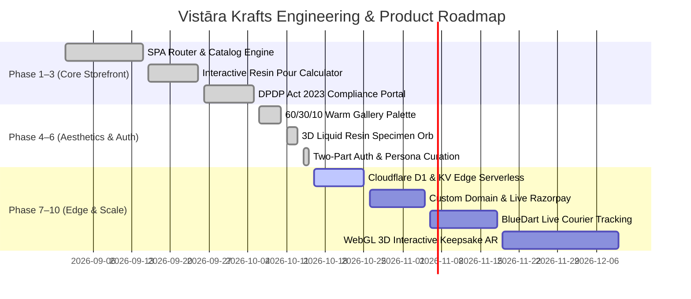

# PRODUCT ROADMAP — VISTĀRA KRAFTS

> **Current Version:** `1.0.0` (Production Release Candidate)  
> **Target Release:** Q4 2026  
> **Production Target:** `https://vistarakrafts.in` (currently hosted on Cloudflare Pages / Vercel preview)  

---

## 🗺️ Milestone Overview & Roadmap Phases

---

## 📍 Phase Breakdown & Deliverables

### ✅ Completed Milestones

#### Phase 1: Core Customer E-Commerce Foundation
- [x] Lightweight vanilla ES module SPA router rendering 7 customer views (`home`, `catalog`, `pdp`, `custom-studio`, `cart`, `account`, `editorial`).
- [x] Zero admin/owner UI leakage guarantee.
- [x] Dynamic volume tier discount calculation (5%, 10%, 15%) and automatic 18% GST (HSN 39073010) line items.
- [x] Studio bag drawer and persistent patron wishlist.

#### Phase 2: Chemical & Studio Calculators
- [x] Dynamic epoxy pour calculator with 3:1 (casting), 2:1 (deep pour), and 1:1 (doming) ratio formulas.
- [x] Rectangular, round/cylindrical, and irregular geometric volume calculations with customizable resin density and wastage safety buffers.

#### Phase 3: DPDP Act 2023 Statutory Compliance
- [x] Privacy notice modal with dual Hindi and English legal disclaimers.
- [x] Granular consent manager for essential processing, analytics, and marketing.
- [x] Section 11 instant JSON data export and Section 12 one-click account erasure.
- [x] Section 13 Grievance Redressal ticketing flow with 7-day statutory resolution SLA.

#### Phase 4: Awwwards-Level Kinetic Design Polish
- [x] 60/30/10 warm gallery brand palette (`#faf8f5` canvas, `#031a38` naval authority, `#b08d57` antique brass).
- [x] 120fps GPU-composited animations with Framer Motion spring tokens (`cubic-bezier(0.16, 1, 0.3, 1)`).
- [x] Strict WCAG 2.2 AA compliance: minimum 44px touch targets across all devices and zero horizontal overflow at 320px viewport.

#### Phase 5: Two-Part Authentication & Persona Feed Curation
- [x] Separated authentication into two clean, unstacked stages:
  - **Part 1:** Credentials (Email/Password or 1-Click Google/Apple). No gender questions during login.
  - **Part 2:** Post-login studio curation asking strictly `👔 Male` or `🌸 Female`.
- [x] Universal feed fallback silently applied if dismissed, without ever exposing a "Universal" button.
- [x] Dynamic catalog feed re-sorting reflecting customer persona preference.

#### Phase 6: Desktop Login Re-Architecture
- [x] Desktop login card divided into two side-by-side stages:
  - **Left Side:** Login & Curation Form (`order-1`, `md:w-7/12`).
  - **Right Side:** 3D Animated Liquid Resin Orb Showcase (`order-2`, `md:w-5/12`).
- [x] Resolved CSS specificity collision on `.hidden` with `.auth-desktop-showcase`.

---

### 🚀 Active & Upcoming Milestones

#### Phase 7: Cloudflare Edge Migration & Database Binding (Active)
- [ ] Connect production Cloudflare D1 database (`vistara_krafts_db`) to Pages Function `/api/*`.
- [ ] Deploy Edge KV namespace for stateless session token validation and instant logout revocation.
- [ ] Bind Cloudflare R2 bucket (`vistara-krafts-media`) for high-resolution customer floral uploads.
- [ ] Swap development Turnstile key (`1x00000000000000000000AA`) with client production key.

#### Phase 8: Custom Domain & Live Razorpay Integration
- [ ] Bind custom domain `https://vistarakrafts.in` with automatic Cloudflare Universal SSL.
- [ ] Connect Razorpay live webhook endpoint (`/api/payments/verify`) with HMAC SHA-256 signature verification.
- [ ] Issue automatic GST invoices on order completion.

#### Phase 9: Real-Time Courier Webhooks & WhatsApp Updates
- [ ] Integrate BlueDart & Delhivery tracking APIs with automated tracking SMS/WhatsApp alerts.
- [ ] Implement live 6-stage floral keepsake progress tracker in patron account dashboard:
  1. Garland Received at Atelier
  2. Moisture & Color Dehydration (7–10 days)
  3. Custom Layout Mockup Approved
  4. 50mm Multi-Layer Optical Epoxy Pour
  5. Pressure Chamber Curing & Diamond Polishing
  6. Dispatched via Express Courier

#### Phase 10: WebGL 3D Specimen Viewer
- [ ] Lightweight Three.js / React Three Fiber interactive preview allowing brides to inspect their custom varmala block from 360 degrees before final casting.
- [ ] Real-time lighting shaders reflecting gold leaf foil and rose quartz inclusions.
