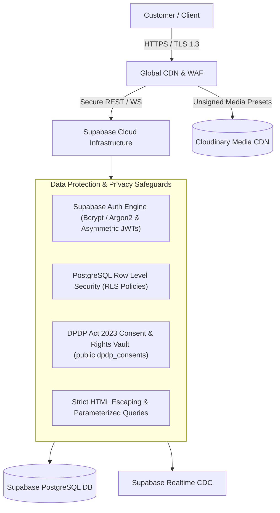

# SECURITY & COMPLIANCE SPECIFICATION — VISTĀRA KRAFTS

> **Regulatory Anchor:** Digital Personal Data Protection (DPDP) Act 2023 (India)  
> **Authentication Engine:** Supabase Auth (Argon2/Bcrypt password hashing & signed JWT tokens)  
> **Database Security:** Supabase PostgreSQL 15+ Row Level Security (RLS)  
> **Media CDN Security:** Cloudinary Unsigned & Signed Presets with strict MIME enforcement  
> **Data Protection Officer (DPO):** Ms. Ananya Sharma (`grievance@vistarakrafts.com`)  

---

## 1. Security Architecture & Threat Model



---

## 2. DPDP Act 2023 Statutory Compliance Engine

Vistāra Krafts is fully engineered to comply with the **Digital Personal Data Protection Act, 2023** enacted by the Government of India:

### 1. Section 6: Lawful Notice & Consent
- **Implementation:** Bilingual statutory modal ([`#dpdp-notice-modal`](file:///C:/Users/Dell/.gemini/antigravity/scratch/stitch_potry_e_commerce_storefront/index.html)) rendering clear disclaimers in English and Hindi.
- **Granular Consent Options:** Customers manage individual processing permissions inside [`#dpdp-preferences-modal`](file:///C:/Users/Dell/.gemini/antigravity/scratch/stitch_potry_e_commerce_storefront/index.html):
  - *Strictly Necessary:* Order fulfillment, GST invoicing, BlueDart courier updates.
  - *Session Analytics:* Shopping bag and custom calculator local storage persistence.
  - *Atelier Circle Notes:* Promotional emails and bridal slot announcements.
- **Persistent Consent Vault:** Consents are logged to `public.dpdp_consents` via `StorefrontBridge.recordConsent()` for audit readiness.

### 2. Section 9: Protection of Minors
- **Implementation:** Mandatory age declaration checkbox required during consent confirmation:
  > *"I confirm that I am 18 years or older, or possess verifiable parental/guardian consent to share personal data."*

### 3. Section 11: Right to Access Data Summary
- **Implementation:** One-click instant data export button (`window.exportDpdpUserData()`).
- **Output:** Downloads a clean, machine-readable JSON document summarizing stored profile details, wishlists, and order history.

### 4. Section 12: Right to Correction & Erasure
- **Implementation:** Instant data erasure trigger (`window.eraseDpdpUserData()`).
- **Action:** Wipes all personal tokens, addresses, order drafts, and uploaded floral photos from browser storage and requests deletion from Supabase.

### 5. Section 13: Grievance Redressal Mechanism
- **Data Protection Officer (DPO):** Ms. Ananya Sharma
- **Official Grievance Email:** `grievance@vistarakrafts.com`
- **Statutory Resolution SLA:** 7 business days from formal ticket submission via [`#dpdp-grievance-modal`](file:///C:/Users/Dell/.gemini/antigravity/scratch/stitch_potry_e_commerce_storefront/index.html).

---

## 3. Authentication & Password Security Standard

When accounts are created via Email and Password, credentials and sessions are managed securely through **Supabase Auth**:
- **Password Protection:** Handled via industry-standard hashing (bcrypt/argon2) on Supabase's hardened authentication infrastructure. Plaintext passwords never touch client storage or database tables.
- **Session Tokens:** Stateless, signed JWTs with automatic token refresh, verified cryptographically on every database request.
- **1-Click OAuth:** Google and Apple OAuth integrations utilizing secure PKCE flows.

---

## 4. Database Access Control & Row Level Security (RLS)

All 8 application tables enforce strict PostgreSQL Row-Level Security:
1. **Public Reads:** `public.products`, `public.settings`, and `public.coupons` are accessible to anonymous storefront visitors (`role = anon`).
2. **Patron Isolation:** Customers can only read and update their own records in `public.profiles` and `public.orders` (`auth.uid() = id` or `auth.uid() = user_id`).
3. **Admin Service Role:** Full management privileges are restricted to the `service_role` key used exclusively by the Admin Portal backend.

---

## 5. Input Sanitization & Attack Mitigation

1. **Cross-Site Scripting (XSS) Prevention:**
   - Every dynamic string injected into innerHTML passes through the strict escaping utility:
     ```javascript
     function esc(str) {
       return String(str || '')
         .replace(/&/g, '&amp;')
         .replace(/</g, '&lt;')
         .replace(/>/g, '&gt;')
         .replace(/"/g, '&quot;')
         .replace(/'/g, '&#039;');
     }
     ```
2. **SQL Injection Prevention:**
   - All Supabase queries use the PostgREST query builder with prepared parameterized statements under the hood.
3. **Cross-Origin Opener Policy (COOP):**
   - Headers configured to `same-origin-allow-popups` to support Google Identity Services and Apple OAuth popup windows safely without cross-window exploitation.
