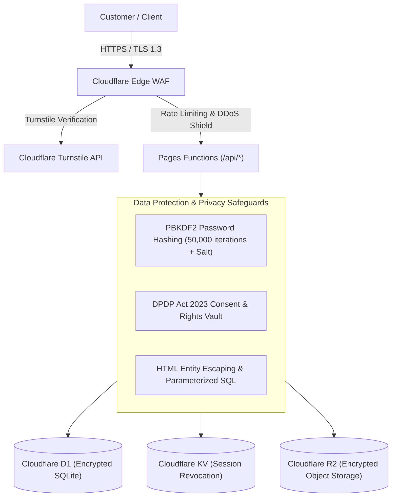

# SECURITY & COMPLIANCE SPECIFICATION — VISTĀRA KRAFTS

> **Regulatory Anchor:** Digital Personal Data Protection (DPDP) Act 2023 (India)  
> **Bot Mitigation:** Cloudflare Turnstile CAPTCHA-less Bot Defense  
> **Cryptographic Engine:** Web Crypto API (PBKDF2-HMAC-SHA256, 50,000 iterations)  
> **Data Protection Officer (DPO):** Ms. Ananya Sharma (`grievance@vistarakrafts.com`)  

---

## 1. Security Architecture & Threat Model



---

## 2. DPDP Act 2023 Statutory Compliance Engine

Vistāra Krafts is fully engineered to comply with the **Digital Personal Data Protection Act, 2023** enacted by the Government of India:

### 1. Section 6: Lawful Notice & Consent
- **Implementation:** Bilingual statutory modal ([`#dpdp-notice-modal`](file:///C:/Users/Dell/.gemini/antigravity/scratch/stitch_potry_e_commerce_storefront/index.html)) rendering clear disclaimers in English and Hindi.
- **Granular Consent Options:** Customers manage individual processing permissions inside [`#dpdp-preferences-modal`](file:///C:/Users/Dell/.gemini/antigravity/scratch/stitch_potry_e_commerce_storefront/index.html):
  - *Strictly Necessary:* Order fulfillment, GST invoicing, BlueDart courier updates.
  - *Session Analytics:* Shopping bag and custom calculator local storage persistence.
  - *Atelier Circle Notes:* Promotional emails and bridal slot announcements.

### 2. Section 9: Protection of Minors
- **Implementation:** Mandatory age declaration checkbox required during consent confirmation:
  > *"I confirm that I am 18 years or older, or possess verifiable parental/guardian consent to share personal data."*

### 3. Section 11: Right to Access Data Summary
- **Implementation:** One-click instant data export button (`window.exportDpdpUserData()`).
- **Output:** Downloads a clean, machine-readable JSON document summarizing stored profile details, wishlists, and order history.

### 4. Section 12: Right to Correction & Erasure
- **Implementation:** Instant data erasure trigger (`window.eraseDpdpUserData()`).
- **Action:** Wipes all personal tokens, addresses, order drafts, and uploaded floral photos from browser storage, D1, and edge sessions.

### 5. Section 13: Grievance Redressal Mechanism
- **Data Protection Officer (DPO):** Ms. Ananya Sharma
- **Official Grievance Email:** `grievance@vistarakrafts.com`
- **Statutory Resolution SLA:** 7 business days from formal ticket submission via [`#dpdp-grievance-modal`](file:///C:/Users/Dell/.gemini/antigravity/scratch/stitch_potry_e_commerce_storefront/index.html).

---

## 3. Cryptography & Password Hashing Standard

When accounts are created via Email and Password, credentials are never stored in plain text:

```javascript
// functions/api/[[route]].js - PBKDF2 Password Hashing
async function hashPasswordPBKDF2(password, saltHex) {
  const enc = new TextEncoder();
  const keyMaterial = await crypto.subtle.importKey(
    'raw',
    enc.encode(password),
    { name: 'PBKDF2' },
    false,
    ['deriveBits']
  );
  const bits = await crypto.subtle.deriveBits(
    {
      name: 'PBKDF2',
      salt: enc.encode(saltHex),
      iterations: 50000,
      hash: 'SHA-256'
    },
    keyMaterial,
    256
  );
  return Array.from(new Uint8Array(bits))
    .map(b => b.toString(16).padStart(2, '0'))
    .join('');
}
```

- **Salt:** 16-byte cryptographically secure random hexadecimal string.
- **Iterations:** 50,000 rounds of SHA-256 HMAC.
- **Output:** 256-bit derived key hex digest.

---

## 4. Bot & Fraud Defense: Cloudflare Turnstile

To protect sign-in forms and order placement from automated credential stuffing and inventory hoarding bots, Cloudflare Turnstile is embedded natively:
- **Dev Sitekey:** `1x00000000000000000000AA` (Always-pass testing key for `localhost`).
- **Server Verification:** Pages Function verifies every incoming `X-CF-Turnstile-Token` against `https://challenges.cloudflare.com/turnstile/v0/siteverify` using the client's private secret before authorizing account creation or order placement.

---

## 5. Input Sanitization & Attack Mitigation

1. **Cross-Site Scripting (XSS) Prevention:**
   - Every dynamic string injected into innerHTML passes through the strict escaping utility:
     ```javascript
     function esc(str) {
       return String(str || '')
         .replace(/&/g, '&amp;')
         .replace(/</g, '&lt;')
         .replace(/>/g, '&gt;')
         .replace(/"/g, '&quot;')
         .replace(/'/g, '&#039;');
     }
     ```
2. **SQL Injection Prevention:**
   - All D1 queries in `functions/api/[[route]].js` use parameterized statements (`env.VISTARA_DB.prepare('SELECT * FROM users WHERE email = ?').bind(email)`).
3. **Cross-Origin Opener Policy (COOP):**
   - Headers configured to `same-origin-allow-popups` to support Google Identity Services and Apple OAuth popup windows safely without cross-window exploitation.
